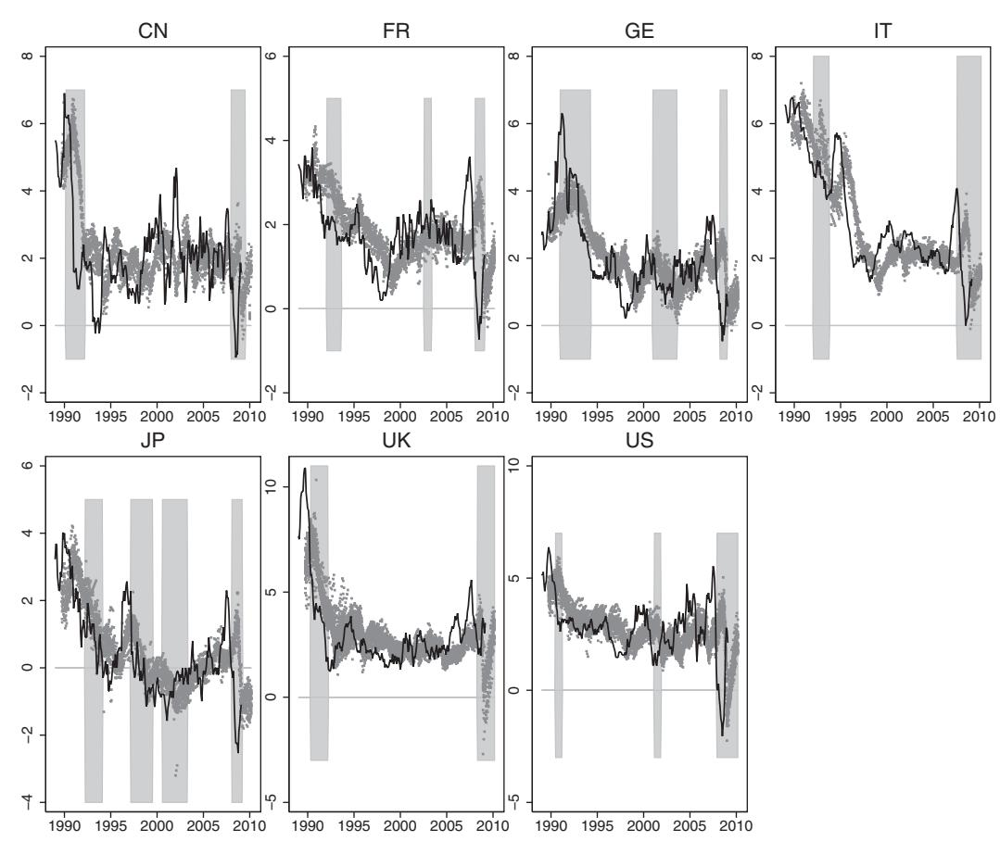
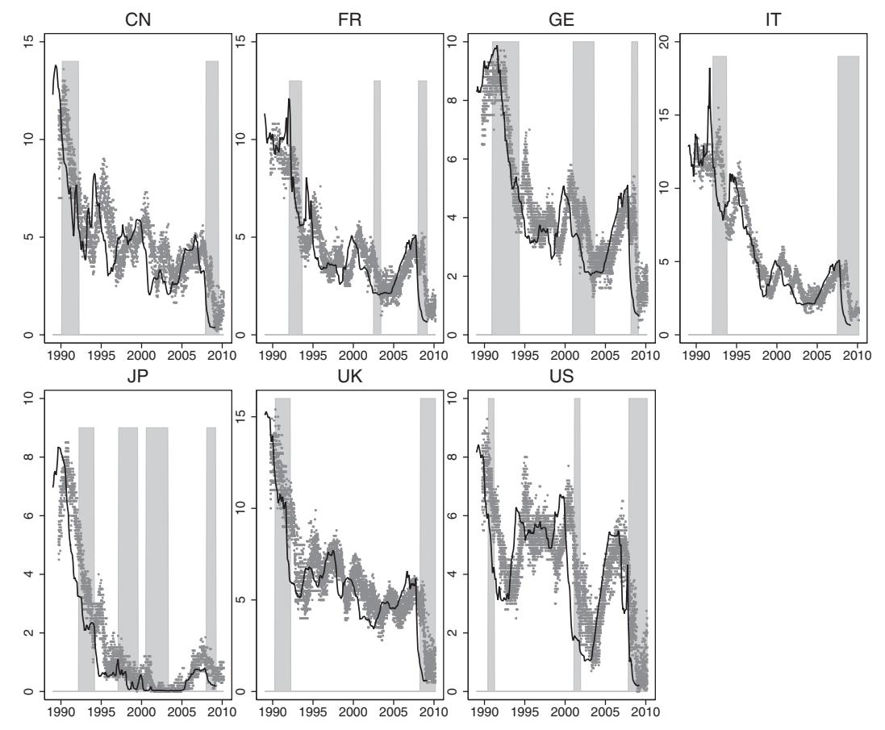
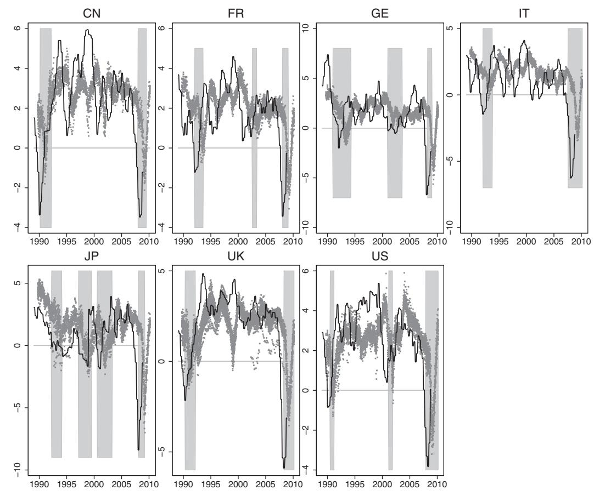
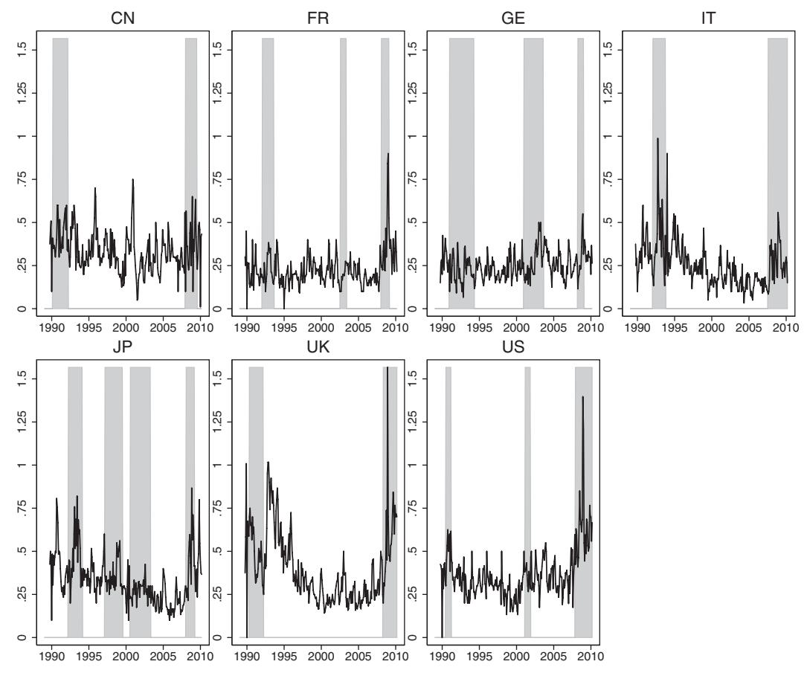
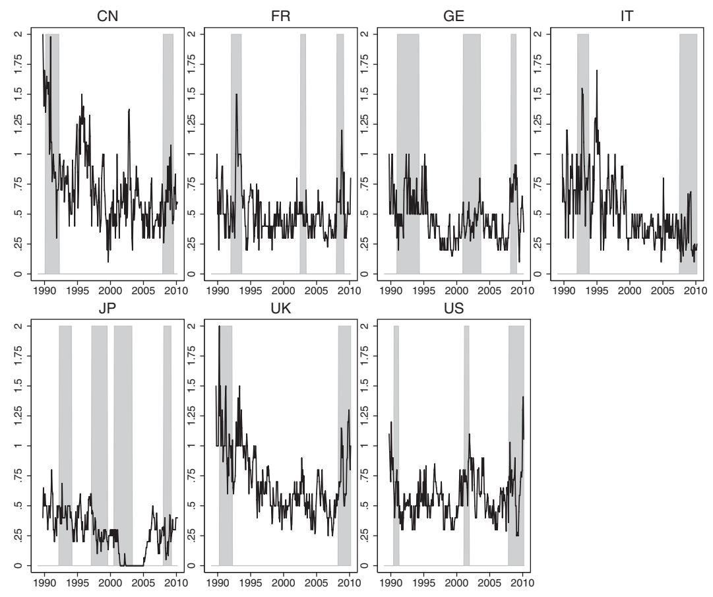
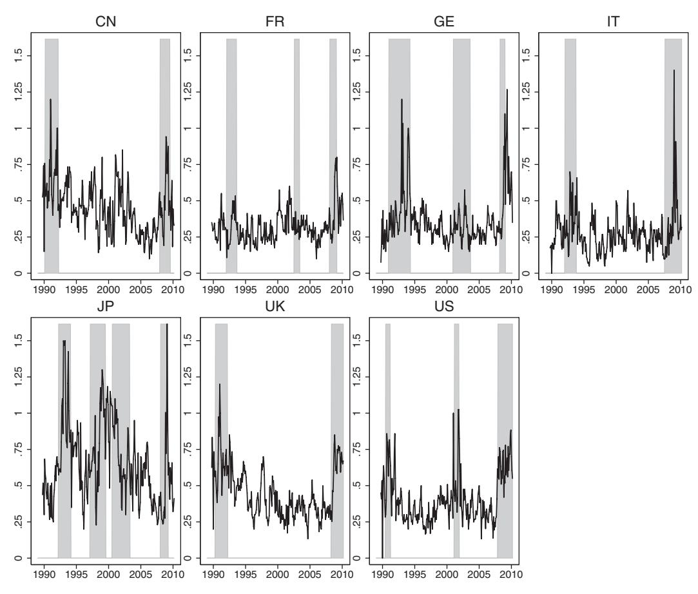

# DISAGREEMENT AMONG FORECASTERS IN G7 COUNTRIES

Jonas Dovern, Ulrich Fritsche, and Jiri Slacalek\*

Abstract—We investigate determinants of disagreement—cross-sectional dispersion of individual forecasts—about key economic indicators. Disagreement about economic activity, in particular about GDP growth, has a distinct dynamic from disagreement about prices: inflation and interest rates. Disagreement about GDP growth intensifies strongly during recessions. Disagreement about prices rises with their level, declines under independent central banks, and both its level and its sensitivity to macroeconomic variables are larger in countries where central banks became independent only around the mid-1990s. Our findings suggest that credible monetary policy contributes to anchoring of expectations about inflation and interest rates. Disagreement for both groups of indicators increases with uncertainty about the actual series.

#### I. Introduction

W E investigate determinants of disagreement (cross-sectional dispersion of forecasts) about three key economic indicators in G7 countries over roughly the past twenty years. Using a unique data set with individual expert forecasts from Consensus Economics, we provide a set of statistics that capture the key features of dynamics of disagreement and are consistently calculated across countries and variables. The data set has been used quite extensively (see the References) but most work investigates the central tendency—consensus—not the cross-sectional distribution of forecasts. Although it is often challenging in large data sets like ours, which covers three variables in seven countries, to find consistent results, to summarize them and interpret, a number of results emerge quite clearly from our analysis.

We find that disagreement about economic activity, in particular about GDP growth, has a distinct dynamic from disagreement about prices: inflation and interest rates. Disagreement about GDP growth intensifies strongly during recessions. Disagreement about prices rises with their level, has fallen after 1998 (by 16%), and is considerably lower under independent central banks (by 33%). For both groups, cross-sectional dispersion increases with uncertainty about the underlying actual indicators.

Our reduced-form estimates also suggest a negative relationship between central bank independence and disagreement about inflation and interest rates. Country-by-country regressions for the two variables reveal that both the level of disagreement and its sensitivity to macroeconomic variables

Received for publication August 19, 2009. Revision accepted for publication March 4, 2011.

\* Dovern: Kiel Economics, Research and Forecasting; Fritsche: University Hamburg; Slacalek: European Central Bank.

We are grateful to Torsten Schünemann, Joanna Sławatyniec, and David Sondermann for excellent research assistance; to Jonathan Wright for helpful comments and programs to estimate the UCSV model; to Lena Dräger, Michael Ehrmann, Michael Lamla, Bernd Lucke, Bartosz Maćkowiak, Jan-Oliver Menz, Adina Popescu, Pierre Siklos, Mark Watson, two referees, and seminar audiences at the Česká národní banka, ECB, EEA 2009 meeting, University Hamburg and ZEW Mannheim for valuable feedback; and to Philip Hubbard for information about the data.

The online appendix with additional results and replication programs is available at http://www.mitpressjournals.org/doi/suppl/10.1162 /REST\_a\_00207. The views presented in this paper are the authors', and do not necessarily reflect those of the European Central Bank.

tend to be larger in Italy, Japan, and the United Kingdom, where central banks became independent only around the mid-1990s. These findings suggest that more credible monetary policy can substantially contribute to anchoring of expectations about prices. In contrast, its effects on disagreement about economic activity are moderate.

We believe our results could be of interest to both policymakers and researchers. The large literature on monetary theory and policy agrees that anchored inflation expectations are of utter importance for safeguarding price stability. Much work (including Cogley & Sargent, 2001; Stock & Watson, 2002, 2005) has documented that the inflation and GDP processes in G7 countries moderated in the late 1980s. and their volatility has been falling further most of the time until recently.1 Our data set confirms the existing findings that the consensus (mean) expectations have also stabilized for most countries and variables. However, for expectations to be perfectly anchored, it is also necessary that their cross-sectional dispersion—disagreement—disappears. Our results document across several countries and variables the extent to which this has been the case and suggest how economic shocks and monetary policy setting contributed to the reduction of disagreement we often find in the 2000s.

Our work builds on two strands of literature on survey expectations. The first and larger area analyzes the central tendency in expectations about inflation, GDP, interest rates, and exchange rates.2 The second body of work, more

1 More precisely, the work typically finds that the variance of the permanent component of inflation and GDP was declining before 2006 or so. In addition, evidence below documents that the average variance of the permanent component of the six series we investigate was typically higher in the 1990s than in the 2000s.

2For example, Branch (2004) estimates a model of boundedly rational agents on inflation expectations from the Survey of Consumer Attitudes and Behavior of the University of Michigan. Ang, Bekaert, and Wei (2007) find that survey expectations provide better inflation forecasts than macrovariables or asset markets. Bernanke and Boivin (2003) and Faust and Wright (2008) compare the Greenbook inflation and GDP forecasts (produced by the U.S. Federal Reserve) to predictions generated by reduced-form econometric models. Kim and Orphanides (2005), Piazzesi and Schneider (2008), and others use interest rate expectations from the U.S. Survey of Professional Forecasters to improve on the existing yield curve models.

Much work uses the Consensus Economics data set, as we do, although often just the central tendency rather than the whole cross-section of observations. For example, Engel and Rogers (2009) and Devereux, Smith, and Yetman (2009) use expectations of consumption, inflation, and exchange rates to test models of international risk sharing. Engel, Mark, and West (2008) feed inflation forecasts into the present-value model of the exchange rate in order to evaluate its forecasting performance. Levin, Natalucci, and Piger (2004) investigate the degree to which inflation expectations are anchored in industrial countries. Patton and Timmermann (2008) study how uncertainty about macroeconomic variables is resolved using forecasts of U.S. inflation and GDP growth. Döpke, Dovern, Fritsche, and Slacalek (2008) estimate the sticky information Phillips curve.

A separate large literature exists on extracting inflation expectations from prices of indexed bonds. For example, Gürkaynak, Levin, and Swanson (2006), Ehrmann, Fratzscher et al. (2011), and Beechey, Johannsen, and Levin (2011) use high-frequency financial data to provide evidence complementary to ours on anchoring of long-run inflation expectations in the euro area, Sweden, the United Kingdom, and the United States.

recent and more closely related, investigates heterogeneity in expectations, often using microdata. The key inspiration for our work is a recent important paper by Mankiw, Reis, and Wolfers (2003), which analyzes central tendency and dispersion of inflation expectations using several U.S. survey data sets and tests some theories of disagreement. A number of recent papers investigate the effect of inflation targeting, increased information about monetary policy, and enhanced central bank transparency on the dispersion of private sector inflation forecasts (Cecchetti & Hakkio, 2009; Siklos, 2009; Capistrán & Ramos-Francia, 2010; Ehrmann, Eijffinger, & Fratzscher, 2010). Separate work by Souleles (2004) uses the Michigan Survey of Consumer Attitudes and Behavior to examine the ability of various groups of population to forecast consumption expenditure. Patton and Timmermann (2010) use a simple reduced-form state-space model to explain the cross-sectional dispersion of U.S. GDP growth and inflation forecasts and argue that forecasters' heterogeneity in prior beliefs is more important than heterogeneity in information sets. Lahiri and Sheng (2008) use the Consensus Economics data to test empirically how a model with Bayesian learning and heterogeneity explains the evolution of disagreement over various forecast horizons. Carroll (2003) bridges the two strands of literature by proposing and testing a model of average inflation and unemployment expectations of households that interacts with those of experts. But joint analysis of individual survey expectations across countries and variables is so far underresearched.

### **II. The Data**

### *A. The Data Set*

We use a leading cross-country survey data set compiled by Consensus Economics, (http://www.consensuseconomics. com/), a London-based economic survey organization.3 Each month, starting in October 1989, Consensus Economics polls experts from public and private economic institutions, mostly investment banks and economic research institutes, about their predictions about the most common macroeconomic indicators. Neither central banks nor governments participate in the survey. Our sample ranges between October 1989 and March 2010 and consists of 246 monthly observations.

While the survey is now conducted in more than twenty countries, the largest sample in terms of length and crosssectional dimension (number of respondents) is available for G7 countries.4 Essentially the same survey is conducted in all G7 countries using the identical procedure: forecasters fill out the survey form mostly electronically in the first two weeks of each month and the data are published around the middle of the month. In addition, country-specific expertise is guaranteed, as most panelists are located in the country they are analyzing. Consequently, the data set is comparable across both countries and panelists and collects some of the best economic forecasts.

The data set covers all principal macroeconomic indicators. We focus on three: consumer price inflation, nominal three-month interest rate, and GDP growth. In addition to these variables, we also investigated disagreement about other series: consumption growth, investment growth, unemployment rate, and industrial production. The results for these four indicators of economic activity are qualitatively similar to those for GDP growth reported below as their disagreement profile broadly tracks GDP growth.5 While the survey contains information on other variables (most important, producer prices, wages, current account, and budget balance), their coverage in terms of time period, countries, and number of respondents is less complete. These additional indicators are also arguably less important and often less closely followed by forecasters than those we focus on.

Before the analysis, we cleaned and transformed the data. The starting point is the expectations series as given in the reports of Consensus Economics. We keep track of the series of each forecaster and attempt to follow them as their institutions merged with others and were taken over or renamed. We visually checked the individual expectations, which substantially differ from others, and made sure they correctly reflect the figures in the reports.6 For each respondent, some observations—typically about 10%—were linearly interpolated when a single observation was missing (and both adjacent monthly observations were available) within a year. In addition, when two observations were missing at the beginning or at the end of the year, they were filled with the March or October observation, respectively.

## *B. Fixed-Event and Fixed-Horizon Forecasts*

Except for interest rates, the respondents give their expectations over the current and the next calendar year; the survey data thus provide series of fixed-event forecasts.7 However, we believe fixed-horizon (e.g., one-year-ahead) forecasts are preferable for the analysis of disagreement because the forecasting horizon of fixed-event forecasts varies from month to

3 Several other data sets of economic forecasts of experts exist in the United States (Survey of Professional Forecasters and the Livingston Survey), Europe (European Central Bank's Survey of Professional Forecasters and Bank of England's Survey of External Forecasters), and Japan (Survey of Japanese Professional Forecasters—ESP Forecast). These surveys typically cover only a single country or economic region (euro area), a subset of variables (most prominently inflation), or a shorter time period than the Consensus Economics survey.

4 Although the survey currently covers all major industrial countries and many emerging economies, data from some relatively large European countries (such as Spain, the Netherlands, or Sweden) have been available only

since December 1994. Expectations about the euro area variables go back only to December 2002 (and are subject to composition effects as new countries joined the monetary union).

5 To conserve space, we report these findings in only the extended working paper version of this paper.

6 It is possible that these outliers could have been due to typing errors by respondents. However, our measure of disagreement, the cross-sectional interquartile range, is robust to the presence of a limited number of outliers.

7 Once every quarter, the survey includes additional questions for selected variables (CPI inflation, GDP, consumption) on the fixed horizon predictions for roughly the following two years. However, these questions are not useful for the analysis of disagreement because only the consensus (mean) forecasts are published.

| Statistic                     | Canada | France | Germany | Italy | Japan | United Kingdom | United States |
|-------------------------------|--------|--------|---------|-------|-------|----------------|---------------|
| INFL                          |        |        |         |       |       |                |               |
| Average number of forecasters | 16.28  | 18.47  | 28.38   | 14.83 | 18.38 | 31.92          | 27.82         |
| Average expectation error     | 0.24   | 0.18   | 0.06    | 0.06  | 0.20  | 0.16           | 0.11          |
| Average MSE                   | 1.78   | 0.77   | 0.93    | 0.97  | 0.97  | 1.53           | 1.90          |
| Average level of INFL         | 2.19   | 1.82   | 2.07    | 3.23  | 0.49  | 3.15           | 2.81          |
| Variance of INFL              | 1.98   | 0.76   | 1.70    | 2.72  | 1.78  | 3.63           | 1.68          |
| Average disagreement          | 0.34   | 0.23   | 0.25    | 0.25  | 0.34  | 0.40           | 0.37          |
| R3M                           |        |        |         |       |       |                |               |
| Average number of forecasters | 15.92  | 17.93  | 25.99   | 11.61 | 17.96 | 30.22          | 26.43         |
| Average expectation error     | 0.59   | 0.10   | 0.27    | 0.25  | 0.45  | 0.56           | 0.43          |
| Average MSE                   | 2.59   | 1.58   | 1.18    | 2.56  | 0.85  | 1.96           | 2.08          |
| Average Level of R3M          | 4.92   | 4.87   | 4.47    | 6.17  | 1.58  | 6.29           | 4.26          |
| Variance of R3M               | 7.90   | 8.22   | 5.76    | 15.80 | 5.53  | 9.50           | 4.24          |
| Average disagreement          | 0.73   | 0.50   | 0.46    | 0.54  | 0.27  | 0.71           | 0.58          |
| GDP growth                    |        |        |         |       |       |                |               |
| Average number of forecasters | 16.05  | 18.56  | 28.07   | 14.85 | 18.63 | 32.55          | 27.85         |
| Average expectation error     | 0.32   | 0.50   | 0.43    | 0.84  | 1.08  | 0.08           | 0.09          |
| Average MSE                   | 4.16   | 2.96   | 5.31    | 4.57  | 6.30  | 3.96           | 3.59          |
| Average level of GDP growth   | 2.27   | 1.70   | 1.54    | 1.00  | 0.67  | 1.98           | 2.55          |
| Variance of GDP growth        | 4.94   | 2.47   | 5.49    | 4.00  | 4.43  | 4.66           | 3.53          |
| Average disagreement          | 0.46   | 0.32   | 0.36    | 0.28  | 0.65  | 0.45           | 0.41          |

TABLE 1.—SUMMARY STATISTICS, ALL COUNTRIES, FULL SAMPLE

Averages taken across forecasters and time periods.

month and consequently their uncertainty and cross-sectional dispersion is strongly seasonal. In addition, we use fixed-horizon forecasts because we want to provide comparable results to much of the literature, including Mankiw et al. (2003).

We approximate fixed-horizon forecasts as a weighted average of fixed-event forecasts as follows. Denote  $\hat{x}_{t+k|t}$  the k-month-ahead forecast of variable x based on the information as of time t. The survey contains for each month a pair of forecasts  $\{\hat{x}_{t+k|t}, \hat{x}_{t+k+12|t}\}$  with horizons  $k \in \{1, 2, \dots, 12\}$  and k+12 months. We approximate the fixed horizon forecast for the next twelve months as an average of the forecasts for the current and next calendar year weighted by their share in forecasting horizon:

$$\tilde{\hat{x}}_{t+12|t} = \frac{k}{12}\hat{x}_{t+k|t} + \frac{12-k}{12}\hat{x}_{t+12+k|t}.$$
 (1)

For example, the November 2008 forecast of inflation rate between November 2008 and November 2009 is approximated by the sum of  $\hat{\pi}_{2008:12|2008:11}$  and  $\hat{\pi}_{2009:12|2008:11}$  weighted by  $\frac{2}{12}$  and  $\frac{10}{12}$ , respectively. We use this procedure for GDP growth and inflation because interest rate expectations are reported as fixed-horizon forecasts of interest rate between now and three months from now.

Because the disagreement series is used only as the dependent variable, the approximation or measurement error in series  $\tilde{x}_{t+12|t}$  from equation (1) does not affect the consistency of the regression estimates obtained below as long as the error is not correlated with the regressors. Such correlation should be relatively low also given the high, monthly frequency of the data.

It is ultimately an empirical question how well our approximation performs. Using fixed-event and fixed-horizon forecasts in the U.S. Survey of Professional Forecasters (SPF) collected by the Federal Reserve Bank of Philadelphia, Dovern and Fritsche (2008) find that approach (1) well

captures the cross-sectional dispersion of predictions. Correlation between cross-sectional dispersion in equation (1) and the true dispersion of fixed-horizon forecasts is roughly 0.8 to 0.9 when measured with standard deviation and 0.6 to 0.9 for the interquartile range (IQR). The remaining nine methods Dovern and Fritsche investigate, including several specifications with unobserved components and seasonal adjustment, typically correlate with the true dispersion at 0.5 to 0.9 for standard deviation and 0.2 to 0.8 for the interquartile range.

In addition, we have done two robustness checks of our results. First, we reestimated the regressions on quarterly 1968–2009 GDP growth data from the U.S. SPF and checked the findings are broadly in line with those of table 4 below. Second, we checked that the results also match those for the restricted Consensus Economics sample, which consists only of actual twelve-month-ahead forecasts.

As the final issue, we need to decide about our preferred measure of cross-sectional dispersion of forecasts. Throughout the paper, we use the width of the interquartile range, the difference between the third and first quartile of observations. We do so to be consistent with the previous work (Mankiw et al., 2003) and because the IQR is also likely to be more robust to outliers than the standard deviation.8

#### C. Descriptive Statistics

Before we analyze disagreement among forecasters in more detail, we will have a closer look at the data. Figures 1 to 3 compare the expected and actual variables. The actual

8The results for disagreement measured with standard deviation are consistent with those presented below, which is not surprising given the relatively high correlation (0.7–0.8) between the two measures. The standard deviation of a normally distributed random variable is proportional to the interquartile range, a fact that on average roughly holds in our data. (The Shapiro–Wilk test does not reject normality in cross-section about 85% to 90% of the time.)

Figure 1.—Expected and Actual Inflation Rate (Percent)

The shaded areas denote recessions as identified by the Economic Cycle Research Institute (using the business cycle method).

series are shifted backward by twelve months so that the vertical difference between them and expectations is the expectation error. (For example, for November 2003, the dots denote expectations of one-year-ahead inflation rate and the actual series is inflation between November 2003 and November 2004.) The shaded areas denote recessions as identified by the Economic Cycle Research Institute (using the business cycle method, which mirrors the NBER procedure).

Three findings appear for all six expectation series. First, expectations are more stable than the actual series. Second, expectations are sensitive to current conditions: expected one-year-ahead rates are quite strongly correlated with the currently observed rates. This sensitivity to current conditions is apparent also for less persistent variables like GDP growth, although to a smaller extent. Third, expectations are sluggish in that they typically overestimate the developments when the underlying variable is falling. This finding is apparent, for example, during the disinflations of the early 1990s when inflation expectations errors were on average positive.

Table 1 summarizes the key descriptive statistics about expectations and actual series. The average number of forecasters, displayed in the first line of each panel, typically ranges between 15 and 35 and shows little systematic variation over time. While in Canada, Japan, and the United States it is approximately constant, it rises somewhat in France, Germany, and Italy and falls in the United Kingdom after 2000 or so. The number of respondents does not correlate with the phase of the business cycle and varies little across variables (in a given country). Observations for each forecaster are available for about half of the time on average.

The second row in each panel shows the mean expectation error averaged across forecasters and time periods. The individual forecasts are not statistically significantly biased partly because the standard deviation of expectation errors is quite large. (The bias of consensus, or mean, forecasts is significant for a few variables in some countries.) Average expectation errors are typically positive, which may reflect forecasters' optimism or sluggishness (where the trend in the underlying variable is falling most of the time, such as in the case of inflation and interest rates).9

9Bias of inflation forecasts tends to be quite high and positive before 1999 and negative afterward. Detailed investigation of bias and efficiency of forecasts is beyond the scope of this paper. A large literature exists on this topic, mostly testing GDP, inflation, and unemployment forecasts, including work that uses our data set, for example, Harvey, Leybourne, and Newbold (2001), Isiklar, Lahiri, and Loungani (2006), Batchelor (2007), and Ager, Kappler, and Osterloh (2009).

Figure 2.—Expected and Actual Short-Term Interest Rates (Percent)

The shaded areas denote recessions as identified by the Economic Cycle Research Institute (using the business cycle method).

Rows 3, 4, and 5 give the average mean squared errors of forecasts, average level of the underlying variable, and its variance, respectively (taken over the sample period October 1989–March 2010). The level and the variance of economic variables can plausibly be positively correlated (see Ball & Cecchetti, 1990, and Ball, 1992, on empirical and theoretical investigation for inflation), and both can positively correlate with the MSEs (and also disagreement).10

### **III. Drivers of Disagreement**

The previous section summarized some key properties of individual expectations. In contrast, this section focuses on the disagreement among forecasters, defined as crosssectional dispersion and measured with the cross-sectional interquartile range, its evolution over time; and its relationship to the business cycle and monetary policy.

## *A. A First Look at Disagreement*

Line 6 in each panel of table 1 summarizes the average disagreement by country and variable. Full-sample time average of disagreement about inflation is relatively low for France, Germany, and Italy. Cross-sectional dispersion of interest rates is quite high in Canada and the United States, relatively low in France and Germany, and extremely low in Japan, the last finding being driven by effectively 0 interest rates for much of the time since 2000. Forecasters in France, Germany, and Italy agree to a large extent on GDP growth, compared to their counterparts in the United Kingdom, Canada, and, in particular, Japan, where the dynamics are again dominated by the recession part of the sample.

Figures 4 to 6 illustrate the evolution of disagreement over time by country and variable. Perhaps unsurprising, given the monthly frequency of our sample, disagreement is subject to much transitory but quite persistent variation. However, two findings arise in several countries and series. First, disagreement tends to rise during recessions. Second, except for the current (2008+) recession, there is a downward time trend in disagreement.

Disagreement about inflation in figure 4 is roughly constant in France and Germany but falls steadily after 1992 or so

10Ball (1992) proposes a model in which the level of inflation and its uncertainty are positively correlated because when inflation is high, policymakers face a dilemma: they would like to disinflate but fear the resulting recession.

Figure 3.—Expected and Actual GDP Growth (Percent)

The shaded areas denote recessions as identified by the Economic Cycle Research Institute (using the business cycle method).

in Italy, as the country was expected to join the euro area, in Japan, and in the United Kingdom. The series is quite strongly countercyclical (in terms of the difference between its average in recessions and booms) in Canada, Italy, Japan, the United Kingdom, and the United States.

As shown in figure 5, before 2008 disagreement about interest rate tends to trend downward in all countries except for France and the United States, and its dynamics is strongly countercyclical (except for Japan where there was little disagreement when the interest rates lied close to 0).

Disagreement about GDP growth in figure 6 is again countercyclical, except for France. In the remaining countries, it is typically 30% to 50% higher in recessions than in booms.

One can think of at least three structural breaks in our sample: the introduction of the euro in January 1999, German reunification in October 1990, and the recent Great Recession. The expectations of the first event seem to have affected disagreement about inflation in Italy, which started to fall following the breakdown of the European exchange rate mechanism in September 1992. Disagreement in the remaining two euro-area members, France and Germany, has been roughly constant, perhaps because the inflation rate in these two countries has been low and stable. Figures 4 to 6 show that the structural break due to the German reunification in October 1990 temporarily elevated disagreement about economic activity but not about inflation and the interest rate. To a large extent unrelated to these two events, there has been much dynamics in disagreement of various series, in particular the clear downward trend in the United Kingdom and cyclical dynamics in most countries. Finally, the onset of the current recession, which started in the late 2007 or in 2008, and especially its intensification in September 2008, substantially increased disagreement for all variables and countries in our sample. We investigate these developments in more detail below using simple regression analysis.

### *B. Disagreement over Time*

To provide quantitative insights tables 2 to 4 use the fixedeffects panel estimator (in which coefficients other than the constant are restricted to be the same in all countries) to assess general trends common in all countries.11

11 The constant term β0 in the tables is normalized to give the average of country-specific intercepts.

Figure 4.—Disagreement about Inflation Rate (Percent)

Disagreement is measured with the cross-sectional interquartile range. Shaded areas denote recessions as identified by the Economic Cycle Research Institute (using the business cycle method).

Panel A of each of tables 2 to 4 investigates how disagreement ("disagr") varies over time and during recessions using two versions of regression:

$$\operatorname{disagr}_{t} = \beta_0 + \beta_1 \times \operatorname{rec}_{t} + \beta_2 \times \operatorname{post-1998}_{t} + u_t,$$

where "rec" denotes the recession dummy and "post-1998" is the dummy for the second part of the sample.

Disagreement about inflation is analyzed in table 2. Row 1 reports that the cross-sectional interquartile range averaged across countries and time is about 0.3, which suggests that half of the forecasters typically lie within 0.15 percentage points of the consensus. Row 2 shows that disagreement rises by about 30% during recessions, a fact that can be due to the increase in general macroeconomic uncertainty, and that disagreement is lower, by 16%, in the second part of the sample, after 1998.

Qualitatively similar findings obtain for disagreement about interest rates and GDP growth and are reported in tables 3 and 4, respectively. For both variables, disagreement rises during recessions and falls after 1998. While disagreement about interest rates is less countercyclical than about inflation, the increase in disagreement about GDP during recessions is substantially larger: 43% (and the fall after 1998 is less pronounced). This seems reasonable as macroeconomic uncertainty during a recession is skewed toward GDP (and less evident for interest rates and, in particular, inflation). The finding is also closely in line with the evidence in Bloom, Floetotto, and Jaimovich (2009), who construct a synthetic index of aggregate uncertainty based on measures of cross-firm and cross-industry dispersion, time variation of aggregate data, and forecaster disagreement (about GDP growth and unemployment rate); the index of Bloom et al. indicates that uncertainty increases by 42.5% during recessions.12

Qualitatively, the estimates (together with those of tables 2 and 3) suggest that the recession differential in disagreement—the difference between average disagreement in a recession and a boom—is generally larger for GDP growth than for prices and interest rates. In contrast, the fall in disagreement after 1998 tends to be smaller for economic activity than for prices.

## *C. An Intermezzo on Macroeconomic Volatility*

Two important broad factors behind the variation in disagreement can be the shocks to economic variables and

12Results for consumption growth, investment growth, and unemployment rate are again qualitatively consistent with those for GDP growth.

FIGURE 5.—DISAGREEMENT ABOUT SHORT-TERM INTEREST RATE (PERCENT)

Disagreement is measured with the cross-sectional interquartile range. Shaded areas denote recessions as identified by the Economic Cycle Research Institute (using the business cycle method).

economic policy. Larger shocks boost the volatility of the underlying actual variables and make them less predictable. As a result, forecasters are more likely to disagree about future outcomes (because they may use different models, priors, subjective probabilities, or data). More credible economic policies can make economic indicators easier to forecast. An obvious example is the introduction of an explicit numerical inflation target, which can contribute to better anchoring of inflation expectations. Similarly, independent central banks are often perceived as better safeguards to price stability (and can indirectly also contribute to the stabilization of output). We investigate these two factors, economic shocks and policies, in a simple reduced-form setup below, but before doing so, we first have to measure them.

To capture the shocks that hit the underlying actual variable  $x_t$ , we employ the following unobserved component stochastic volatility (UCSV) model of Stock and Watson (2007), a simple, canonical device to decompose a series into the permanent and the transitory part with time-varying volatility. Intuitively, the dynamics of  $x_t$  are driven by a permanent

component  $\tau_t$  with white noise innovations  $\varepsilon_t$  and a transitory component  $\eta_t$ :

$$x_t = \tau_t + \eta_t, \tag{2}$$

$$\tau_t = \tau_{t-1} + \varepsilon_t. \tag{3}$$

Both  $\eta_t$  and  $\varepsilon_t$  are independently normally distributed and have time-varying (random-walk) variances  $\sigma^2_{\eta,t}$  and  $\sigma^2_{\varepsilon,t}$ , respectively  $(\eta_t \sim \mathcal{N}(0, \sigma^2_{\eta,t}), \varepsilon_t \sim \mathcal{N}(0, \sigma^2_{\varepsilon,t}))$ :

$$\log \sigma_{n,t}^2 = \log \sigma_{n,t-1}^2 + \nu_{\eta,t},\tag{4}$$

$$\log \sigma_{\epsilon,t}^2 = \log \sigma_{\epsilon,t-1}^2 + \nu_{\epsilon,t}. \tag{5}$$

Innovations to variances  $v_t = (v_{\eta,t}, v_{\epsilon,t})$  are i.i.d.  $\mathcal{N}(0, \gamma I_2)$ , and  $\gamma$  is a scalar parameter that controls the smoothness of the estimated volatilities  $\sigma_{\cdot,t}^2$ . We estimate the model with Gibbs sampling. We use the UCSV model as a flexible device to capture the variation of volatility of shocks over time. In the regressions below, we investigate how disagreement correlates with the variance  $\sigma_{\epsilon,t}^2$  because permanent

&lt;sup>13 The same specification is used in Wright (2011) to model inflation; Stock and Watson (2002, 2005) propose variants of this model for GDP, consumption, investment, employment, and many other variables. Similar, more sophisticated models are analyzed in Harvey and Trimbur

(2003), Creal, Koopman, and Zivot (2008), Giordani and Kohn (2008), and elsewhere.

 $^{14}\,\mathrm{The}$  online appendix shows the diagnostics we used to assess the quality and convergence of the MCMC approximation.

FIGURE 6.—DISAGREEMENT ABOUT GDP GROWTH (PERCENT)

Disagreement is measured with the cross-sectional interquartile range. Shaded areas denote recessions as identified by the Economic Cycle Research Institute (using the business cycle method).

uncertainty driven by shocks  $\varepsilon_t$  is much more important for the formation of expectations (over the next twelve months) than transitory uncertainty due to  $\eta_t$ , which subsides immediately.15

Estimates of the variance of permanent shocks  $\sigma_{\epsilon,t}^2$  reveal that it is positively related to the path of disagreement. Forecasters disagree more when the economy is hit with larger permanent shocks, in particular, in recessions but to a lesser extent also before 1999 (compared to the post-1998 period). Both economic shocks and disagreement are more substantial during recessions and tended to be more muted in the second part of our sample (before the Great Recession). In addition, the countercyclicality of disagreement and shocks

15 As a robustness exercise, we have also proxied uncertainty about the underlying variable  $x_t$  simply with its one-year squared difference  $\Delta_{12}x_t^2 = (x_t - x_{t-12})^2$ . An advantage of that measure is that it is independent of the parametric model used to back out  $\sigma_{\epsilon,t}^2$ . For specifications (2)–(5),  $\Delta x_t = \varepsilon_t + \eta_t - \eta_{t-1}$  and  $\mathbf{E}(\Delta x_t^2) = \sigma_{\epsilon,t}^2 + 2\sigma_{\eta,t}^2$ . Estimation results for this alternative measure of uncertainty ( $\Delta_{12}x_t^2$ ) are broadly consistent with the baseline shown in sections IIID and IIIE. One difference is that disagreement about inflation correlates more strongly with  $\Delta_{12}INFL_t^2$  than with  $\sigma_{INFL,\epsilon,t}^2$ . This is not surprising because both measures of uncertainty comove quite closely, with correlation of more than 0.4. (Estimation results and comparison plots of  $\Delta_{12}x_t^2$  and  $\sigma_{x,\epsilon,t}^2$  are shown in the online appendix.)

is somewhat more pronounced for economic activity than for inflation.

#### D. Disagreement and Macrovariables

Panel B of Tables 2 to 4 investigates how disagreement correlates with the level of the underlying actual variables, uncertainty about these variables proxied with the variance of permanent shocks, output gap,  $^{16}$  and the squared change in the policy interest rate ( $\Delta$ policyrate $_t^2$ )—a proxy of the variation in (and uncertainty about) monetary policy:

$$\operatorname{disagr}_{t} = \beta_{0} + \beta_{2} \times x_{t} + \beta_{3} \times \sigma_{x,t}^{2} + \beta_{4} \times \operatorname{output } \operatorname{gap}_{t} + \beta_{5} \times \Delta \operatorname{policy } \operatorname{rate}_{t}^{2} + u_{t},$$

where  $x_t$  denotes the level of the underlying variable and  $\sigma_{x,t}^2$  is a shorthand notation for the variance  $\sigma_{x,\varepsilon,t}^2$  of permanent shocks to  $x_t$ , as given in equation (5).

Disagreement about inflation rate increases with its level: a 1 percentage point increase in inflation raises the cross-sectional interquartile range by 0.018, or about 6% (with

16The output gap used here is the ex post estimate taken from OECD's Economic Outlook. The series is quarterly, interpolated constant within each quarter, and starts in 1991:Q1.

TABLE 2.—DISAGREEMENT AND BUSINESS CYCLE: PANEL RESULTS, INFL

|       |                    | 1.1522 2.                           | DIGITOREE MET TE                                         | E Been Lees Creek                                                 | . T.E.EE TESSEIS, E                    |                                    |                |       |
|-------|--------------------|-------------------------------------|----------------------------------------------------------|-------------------------------------------------------------------|----------------------------------------|------------------------------------|----------------|-------|
| Model | $\beta_0$          | $\beta_1$                           | $\beta_2$                                                | $\beta_3$                                                         | $\beta_4$                              | $\beta_5$                          | $\bar{R}^2$    | $R^2$ |
|       |                    |                                     | A. Disa                                                  | agreement over Tim                                                | ie                                     |                                    |                |       |
|       |                    |                                     | $disagr_t = \beta_0 + \beta_1$                           | $\times \operatorname{rec}_t + \beta_2 \times \operatorname{pos}$ | $t-1998_t + u_t$                       |                                    |                |       |
| 1     | 0.311***           |                                     |                                                          |                                                                   |                                        |                                    | -0.003         | 0.000 |
|       | (0.003)            |                                     |                                                          |                                                                   |                                        |                                    |                |       |
| 2     | 0.316***           | 0.096***                            | -0.051***                                                |                                                                   |                                        |                                    | 0.107          | 0.112 |
|       | (0.005)            | (0.020)                             | (0.015)                                                  |                                                                   |                                        |                                    |                |       |
|       |                    |                                     | B. Disagree                                              | ment and Macro Va                                                 | riables                                |                                    |                |       |
|       |                    | $disagr_t = \beta_0 + \beta$        | $_{2} \times INFL_{t} + \beta_{3} \times \sigma_{t}^{2}$ | $^{2}_{NFI}$ , $+\beta_{4} \times output$                         | $gap_t + \beta_5 \times \Delta police$ | cy rate $_t^2 + u_t$               |                |       |
| 3     | 0.270***           |                                     | 0.018***                                                 | 111 2,6                                                           |                                        |                                    | 0.028          | 0.032 |
|       | (0.006)            |                                     | (0.006)                                                  |                                                                   |                                        |                                    |                |       |
| 4     | 0.199***           |                                     | 0.026***                                                 | 0.425***                                                          | -0.022***                              | 0.054**                            | 0.238          | 0.243 |
|       | (0.007)            |                                     | (0.004)                                                  | (0.072)                                                           | (0.004)                                | (0.022)                            |                |       |
|       |                    |                                     | C. Disagreement                                          | and Central Bank Ir                                               | ndependence                            |                                    |                |       |
|       | $disagr_t = \beta$ | $\beta_0 + \beta_1 \times CB$ Indep | pendence t + $\beta_2 \times IN$              | $FL_t + \beta_3 \times \sigma_{INFI}^2$ ,                         | $+\beta_4 \times \text{output gap,} -$ | $+\beta_5 \times \Delta policy ra$ | $te_t^2 + u_t$ |       |
| 5     | 0.411***           | -0.120***                           |                                                          | i i iii.                                                          |                                        |                                    | 0.078          | 0.082 |
|       | (0.006)            | (0.027)                             |                                                          |                                                                   |                                        |                                    |                |       |
| 6     | 0.307***           | -0.102***                           | 0.016***                                                 | 0.422***                                                          | -0.022***                              | 0.040*                             | 0.286          | 0.291 |
|       | (0.012)            | (0.026)                             | (0.005)                                                  | (0.074)                                                           | (0.003)                                | (0.021)                            |                |       |
|       | 0.307***           | (0.027) -0.102***                |                                                          |                                                                   | ****==                                 |                                    |                |       |

Fixed-effects estimators, HAC standard errors, Bartlett kernel, bandwidth = 12 lags. The dependent variable is measured as cross-sectional IQR. Number of observations: 246.  $\beta_0$  denotes the average of country-specific intercepts; "post-1998," denotes a dummy variable that equals 0 before 1999 and 1 after 1998; "recession," denotes a dummy variable that equals 1 during recession set by the Economic Cycle Research Institute (ECRI) and 0 otherwise; "output gap," denotes the ex post output gap estimated in the OECD Economic Outlook quarterly output gap revisions database (in April 2010).  $\sigma_{NFL,i}^2$  denotes variance of the permanent component of INFL. "CB Independence," denotes a 0–1 indicator of independent monetary policy defined in table 5. Statistical significance at "10%, "5%, and "\*1]%.

TABLE 3.—DISAGREEMENT AND BUSINESS CYCLE: PANEL RESULTS, R3M

| Model | $\beta_0$           | $\beta_1$                           | $\beta_2$                                       | β 3                                                    | $\beta_4$                           | β 5                        | $\bar{R}^2$  | $R^2$ |
|-------|---------------------|-------------------------------------|-------------------------------------------------|-------------------------------------------------------------------|-------------------------------------|---------------------------------------|--------------|-------|
|       |                     |                                     | A. Disag                                        | reement over Tim                                                  | ie                                  |                                       |              |       |
|       |                     |                                     | $\operatorname{disagr}_{t} = \beta_0 + \beta_1$ | $\times \operatorname{rec}_t + \beta_2 \times \operatorname{pos}$ | $t-1998_t + u_t$                    |                                       |              |       |
| 1     | 0.542***            |                                     |                                                 |                                                                   |                                     |                                       | -0.003       | 0.000 |
|       | (0.006)             |                                     |                                                 |                                                                   |                                     |                                       |              |       |
| 2     | 0.625***            | 0.120***                            | -0.204***                                       |                                                                   |                                     |                                       | 0.204        | 0.208 |
|       | (0.008)             | (0.030)                             | (0.026)                                         |                                                                   |                                     |                                       |              |       |
|       |                     |                                     | B. Disagreem                                    | ent and Macro Va                                                  | riables                             |                                       |              |       |
|       |                     | disagr, = $\beta_0 + \beta_2$       | $\times R3M_t + \beta_3 \times \sigma_{R3}^2$   | $_{\rm ML} + \beta_4 \times {\rm output}$                         | gap, $+\beta_5 \times \Delta polic$ | y rate $^2 + u_t$                     |              |       |
| 3     | 0.354***            | 01 10 12                            | 0.040***                                        | и,,,                                                              |                                     |                                       | 0.213        | 0.217 |
|       | (0.010)             |                                     | (0.005)                                         |                                                                   |                                     |                                       |              |       |
| 4     | 0.322***            |                                     | 0.041***                                        | 0.226                                                             | -0.023***                           | 0.047*                                | 0.282        | 0.287 |
|       | (0.011)             |                                     | (0.008)                                         | (0.171)                                                           | (0.007)                             | (0.024)                               |              |       |
|       | , ,                 |                                     | C. Disagreement an                              | d Central Bank Ir                                                 | dependence                          | , ,                                   |              |       |
|       | disagr. $= \beta_0$ | $_{0} + \beta_{1} \times CB$ Indepe | $ndence_t + \beta_2 \times R3M$                 |                                                                   |                                     | - β 5 × Δpolicy ra         | $te^2 + u_t$ |       |
| 5     | 0.772***            | -0.277***                           |                                                 | R3M,t                                                             | 14 F- 8-F1                          | , , , , , , , , , , , , , , , , , , , | 0.139        | 0.143 |
| -     | (0.010)             | (0.036)                             |                                                 |                                                                   |                                     |                                       |              |       |
| 6     | 0.427***            | -0.093*                             | 0.036***                                        | 0.171                                                             | -0.024***                           | 0.044*                                | 0.292        | 0.297 |
|       | (0.024)             | (0.050)                             | (0.010)                                         | (0.167)                                                           | (0.007)                             | (0.025)                               |              |       |

Fixed-effects estimators, HAC standard errors, Bartlett kernel, bandwidth = 12 lags. The dependent variable is measured as cross-sectional IQR. Number of observations: 246,  $\beta_0$  denotes the average of country-specific intercepts; "post-1998," denotes a dummy variable that equals 1 during recession set by the Economic Cycle Research Institute (ECR1) and 0 otherwise; "output gap," denotes the ex post output gap estimated in the OECD Economic Outlook quarterly output gap revisions database (in April 2010);  $\sigma_{RMJ}^2$  denotes variance of the permanent component of R3M; "CB Independence," denotes a 0–1 indicator of independent monetary policy defined in table 5. Statistical significance at \*10%, \*\*5%, and \*\*\*1%.

respect to the mean 0.311). The direct effect of inflation uncertainty (the term  $\sigma^2_{INFL,t}$ ) is signed positively, in line with our prior (and with the work of Ball, 1992) and statistically significant. The coefficient on the output gap is negative, which matches the previous evidence that disagreement increases during recessions. Finally, disagreement about inflation rises when monetary policy rates change, which again tends to coincide with recessions. (But the positive coefficient on interest rates is significant even when output gap is included.) In addition, including interest rates among explanatory variables increases the explanatory power of the regression.

Similar to inflation, disagreement about interest rates shown in table 3 rises with the level, uncertainty, and squared change of rates. These findings are in line with the fact reported in panel A that disagreement about interest rates fell after 1998, as both the level and variation in rates is much lower in the second part of the sample (see also figure 2). In addition, disagreement also tends to move inversely to the output gap. While the coefficients in these regressions are comparable to those for inflation and GDP growth, their explanatory power is higher.

Table 4 analyzes drivers of disagreement about GDP growth. In contrast to inflation and interest rates but in line

TABLE 4.—DISAGREEMENT AND BUSINESS CYCLE: PANEL RESULTS, GDP GROWTH

| Model | $\beta_0$           | $\beta_1$                        | $\beta_2$                                        | $\beta_3$                                                        | $\beta_4$                               | $\beta_5$                            | $\bar{R}^2$    | $R^2$ |
|-------|---------------------|----------------------------------|--------------------------------------------------|------------------------------------------------------------------|-----------------------------------------|--------------------------------------|----------------|-------|
|       |                     |                                  | A. Disa                                          | ngreement over Ti                                                | me                                      |                                      |                |       |
|       |                     |                                  | $disagr_t = \beta_0 + \beta_1$                   | $\times \operatorname{rec}_t + \beta_2 \times \operatorname{pc}$ | $0st-1998_t + u_t$                      |                                      |                |       |
| 1     | 0.417***            |                                  |                                                  |                                                                  | •                                       |                                      | -0.003         | 0.000 |
|       | (0.004)             |                                  |                                                  |                                                                  |                                         |                                      |                |       |
| 2     | 0.392***            | 0.167***                         | -0.028                                           |                                                                  |                                         |                                      | 0.142          | 0.147 |
|       | (0.007)             | (0.023)                          | (0.018)                                          |                                                                  |                                         |                                      |                |       |
|       |                     |                                  | B. Disagreer                                     | ment and Macro V                                                 | Variables                               |                                      |                |       |
|       |                     | disagr, $= \beta_0 + \beta_2$    | $2 \times \Delta GDP_t + \beta_3 \times \sigma$  | $\frac{2}{CDR}$ , + $\beta_4 \times$ outr                        | out gap, $+\beta_5 \times \Delta p$     | olicy rate 2 + $u_t$      |                |       |
| 3     | 0.478***            | 01 10 11                         | -0.037***                                        | GDF,t · · · · · · · · · · · · · · · · · · ·                      |                                         | , , , ,                              | 0.165          | 0.169 |
|       | (0.005)             |                                  | (0.004)                                          |                                                                  |                                         |                                      |                |       |
| 4     | 0.433***            |                                  | -0.022***                                        | 0.053                                                            | -0.022***                               | 0.070*                               | 0.207          | 0.212 |
|       | (0.010)             |                                  | (0.006)                                          | (0.099)                                                          | (0.007)                                 | (0.036)                              |                |       |
|       |                     |                                  | C. Disagreement a                                | and Central Bank                                                 | Independence                            |                                      |                |       |
|       | disagr. = $\beta_0$ | $+\beta_1 \times CB$ Independent | endence t + $\beta_2 \times \Delta G$ | $DP_t + \beta_3 \times \sigma_{cpp}^2$                           | $+\beta_4 \times \text{output gain}$    | $p_* + \beta_5 \times \Delta policy$ | $rate^2 + u_t$ |       |
| 5     | 0.466***            | -0.059*                          |                                                  | GDP                                                              | ,,,,,,,,,,,,,,,,,,,,,,,,,,,,,,,,,,,,,,, | 11 113 11 17                         | 0.007          | 0.012 |
|       | (0.005)             | (0.035)                          |                                                  |                                                                  |                                         |                                      |                |       |
| 6     | 0.488***            | -0.069**                         | -0.021***                                        | 0.051                                                            | -0.024***                               | 0.057*                               | 0.221          | 0.227 |
|       | (0.014)             | (0.027)                          | (0.006)                                          | (0.100)                                                          | (0.006)                                 | (0.034)                              |                |       |

Fixed-effects estimators, HAC standard errors, Bartlett kernel, bandwidth = 12 lags. The dependent variable is measured as cross-sectional IQR. Number of observations: 246.  $\beta_0$  denotes the average of country-specific intercepts; "post-1998," denotes a dummy variable that equals 1 during recession set by the Economic Cycle Research Institute (ECRI) and 0 otherwise; "output gap," denotes the expost output gap estimated in the OECD Economic Outlook quarterly output gap revisions database (in April 2010);  $\sigma_{GDP,t}^2$  denotes variance of the permanent component of GDP; "CB Independence," denotes a 0-1 indicator of independent monetary policy defined in table 5. Statistical significance at \*10%, \*\*5%, and \*\*\*1%.

TABLE 5 — CENTRAL BANK INDEPENDENCE IN G7 COUNTRIES

| Country                         | Monetary Policy Setting                                                                         | Dummy Variable                                   | Fraction of Sample with Independent CB |
|---------------------------------|-------------------------------------------------------------------------------------------------|--------------------------------------------------|----------------------------------------|
| Canada                          | De facto independent central bank; a                                                 | 1 full sample                                    | 1                                      |
| France b             | Independent central bank since August 4, 1993                                                   | 0 before August 1993, 1 otherwise                | $\frac{159}{246} = 0.65$               |
| Germany b            | Independent central bank since August 1, 1957                                                   | 1 full sample                                    | 1                                      |
| Italy b              | Independent central bank effectively since January 1, 1994b                                     | 0 before January 1994, 1 otherwise               | $\frac{154}{246} = 0.63$               |
| Japan                           | Independent central bank since June 18, 1997                                                    | 0 before July 1997, 1 otherwise                  | $\frac{112}{246} = 0.46$               |
| United Kingdom United States | Independent central bank since June 1, 1998 Independent central bank since December 23, 1913 | 0 before June 1998, 1 otherwise 1 full sample | $\frac{101}{246} = 0.41$               |

&lt;sup>aBank of Canada was technically independent until 1967 and has been de jure dependent on the Minister of Finance since then. (Inflation targeting since February 1991.) bRefers to the period before the country joined the euro area.

Sources: Web pages of the respective central banks

with the evidence of panel A, disagreement about GDP growth moves inversely with its level: disagreement rises in periods of weak economic growth. Arguably, the effects of GDP growth on disagreement are nonlinear: disagreement can be expected to rise during periods of heightened uncertainty, which likely occur during recessions but also when economic growth accelerates considerably. (However, the latter periods are virtually absent in our sample as GDP growth only rarely exceeds 5%.) In fact, the coefficient on shocks to GDP  $\sigma^2_{GDP,t}$  is estimated to be positive but insignificant. As for disagreement about inflation and interest rates, variation in interest rates analyzed in model 4 also improves the performance of the regression (measured with adjusted and plain  $R^2$ ).

Our findings in this and the previous section are in line with Mankiw et al. (2003) and Döpke and Fritsche (2006). Mankiw et al. (2003) report that in the United States, disagreement about inflation increases with its level and absolute value of its change, in particular when the change is sharp, and though it shows countercyclical pattern after 1975 or so for consumers, its dependence on the phase of the business cycle is less clear for experts. Döpke and Fritsche (2006) find that dispersion of inflation and growth expectations in Germany

is high before and during recessions and correlates positively with macroeconomic uncertainty.

#### E. Disagreement and Central Bank Independence

It might be a priori expected that better macroeconomic policy reduces economic uncertainty and disagreement. Without going into much detail about measuring the quality of economic institutions, panel C of tables 2 to 4 provides a simple illustration of how much better and more credible monetary policy affects disagreement about various variables. In particular, we attempt to capture the credibility of monetary policy using an indicator of central bank independence as defined in table 5.17

17 We intentionally use a simple indicator, which transparently tracks central bank independence throughout our sample. The indicator is broadly in line with a measure of political autonomy of central banks recently calculated by Arnone et al. (2009), who use the methodology proposed by Grilli, Masciandaro, and Tabellini (1991) and Cukierman (1992). Their approach defines political autonomy as the ability of central banks to select the final objectives of monetary policy and measures it using a combination of eight criteria related to how the governor and the board of directors are appointed, the relations with government, and the nature of the laws relevant for central banks.

&lt;sup>cFormally since February 7, 1992; however, granting of independence was effectively not completed until 1994.

| TABLE 6.—DISAGREEMENT | AND BUSINESS | Cycle: Country-1 | RY-COUNTRY | RESULTS INFL. |
|-----------------------|--------------|------------------|------------|---------------|
|                       |              |                  |            |               |

| Country        | βο           | β1                                  | $\beta_2$                                     | β3                                                    | $\beta_4$                                     | $\bar{R}^2$ | $R^2$ |
|----------------|--------------|-------------------------------------|-----------------------------------------------|-------------------------------------------------------|-----------------------------------------------|-------------|-------|
|                |              |                                     | A. Disagreement ove                           |                                                       |                                               |             |       |
|                |              |                                     |                                               | $+\beta_2 \times \text{post-}1998_t +$                | $-u_t$                                        |             |       |
| Canada         | 0.353***     | 0.072***                            | -0.053**                                      |                                                       |                                               | 0.098       | 0.105 |
|                | (0.018)      | (0.020)                             | (0.022)                                       |                                                       |                                               |             |       |
| France         | 0.202***     | 0.062                               | 0.024                                         |                                                       |                                               | 0.059       | 0.066 |
|                | (0.013)      | (0.044)                             | (0.023)                                       |                                                       |                                               |             |       |
| Germany        | 0.224***     | 0.004                               | 0.047***                                      |                                                       |                                               | 0.072       | 0.080 |
|                | (0.012)      | (0.020)                             | (0.018)                                       |                                                       |                                               |             |       |
| Italy          | 0.308***     | 0.101***                            | -0.138***                                     |                                                       |                                               | 0.335       | 0.340 |
|                | (0.020)      | (0.026)                             | (0.022)                                       |                                                       |                                               |             |       |
| Japan          | 0.371***     | 0.068*                              | -0.112***                                     |                                                       |                                               | 0.199       | 0.205 |
|                | (0.025)      | (0.035)                             | (0.035)                                       |                                                       |                                               |             |       |
| United Kingdom | 0.466***     | 0.176**                             | -0.179***                                     |                                                       |                                               | 0.281       | 0.287 |
|                | (0.060)      | (0.090)                             | (0.062)                                       |                                                       |                                               |             |       |
| United States  | 0.314***     | 0.229***                            | 0.022                                         |                                                       |                                               | 0.360       | 0.366 |
|                | (0.011)      | (0.058)                             | (0.021)                                       |                                                       |                                               |             |       |
|                |              | B. Di                               | sagreement and Mac                            | ro Variables                                          |                                               |             |       |
|                | disagreement | $= \beta_0 + \beta_1 \times INFL_t$ | $+\beta_2 \times \sigma_{INFL,t}^2 + \beta_3$ | $\times$ output gap t + $\beta_4$ $\times$ | $\triangle$ Dpolicy rate 2 + $u_t$ |             |       |
| Canada         | 0.276***     | 0.023***                            | -0.041                                        | -0.013***                                             | 0.056***                                      | 0.133       | 0.147 |
|                | (0.029)      | (0.005)                             | (0.135)                                       | (0.005)                                               | (0.018)                                       |             |       |
| France         | 0.161***     | 0.001                               | 0.991***                                      | $-0.011^{*}$                                          | 0.143                                         | 0.251       | 0.263 |
|                | (0.027)      | (0.011)                             | (0.271)                                       | (0.006)                                               | (0.124)                                       |             |       |
| Germany        | 0.252***     | -0.014***                           | 0.235                                         | -0.010**                                              | 0.158                                         | 0.113       | 0.129 |
|                | (0.021)      | (0.004)                             | (0.160)                                       | (0.005)                                               | (0.118)                                       |             |       |
| Italy          | 0.079***     | 0.041***                            | 0.417                                         | -0.023***                                             | 0.074***                                      | 0.387       | 0.397 |
| •              | (0.021)      | (0.005)                             | (0.278)                                       | (0.007)                                               | (0.018)                                       |             |       |
| Japan          | 0.192***     | 0.035**                             | 1.326***                                      | -0.015**                                              | 0.005                                         | 0.314       | 0.326 |
| 1              | (0.024)      | (0.015)                             | (0.215)                                       | (0.008)                                               | (0.011)                                       |             |       |
| United Kingdom | 0.271***     | 0.056***                            | -0.965                                        | -0.078***                                             | 0.127*                                        | 0.406       | 0.416 |
|                | (0.045)      | (0.016)                             | (0.694)                                       | (0.024)                                               | (0.074)                                       |             |       |
| United States  | 0.224***     | 0.020**                             | 0.424***                                      | -0.026***                                             | 0.128***                                      | 0.463       | 0.472 |
|                | (0.028)      | (0.009)                             | (0.082)                                       | (0.007)                                               | (0.048)                                       | 000         | 0/2   |

Country-by-country regressions, Newey-West standard errors, twelve lags. The dependent variable is measured as cross-sectional IQR. Number of observations: 246.  $\beta_0$  denotes the average of country-specific intercepts; "post-1998," denotes a dummy variable that equals 0 before 1999 and 1 after 1998; "rec;" denotes a dummy variable that equals 1 during recession set by the Economic Cycle Research Institute (ECRI) and 0 otherwise;  $\sigma_{NFL,I}^2$  denotes variance of the permanent component of INFL; "output gap," denotes the ex post output gap estimated in the OECD *Economic Outlook* quarterly output gap revisions database (in April 2010). Statistical significance at \*10%, \*\*5%, and \*\*\*1%.

We estimate two versions of the following regression:

disagrt = 
$$\beta_0 + \beta_1 \times \text{CB Independence}_t$$
  
+  $\beta_2 \times x_t + \beta_3 \times \sigma_{x,t}^2 + \beta_4 \times \text{output gap}_t$   
+  $\beta_5 \times \Delta \text{policyrate}_t^2 + u_t$ .

Although the dummy for central bank independence (CBIndependencet) is negative for all variables, it is substantially larger for inflation and the interest rate. Quantitatively, the reduction in disagreement related to central bank independence is largest for the two price variables, interest rates and inflation—36% and 29%, respectively; for GDP growth, it amounts to 13%. In addition, while the explanatory power of these regressions for prices is larger than those with recession dummies only, this result reverses for economic activity (where adjusted  $R^2$ s of model 4 are low).

Model 6 attempts to separate the effects of central bank independence and other factors (by including macroeconomic control variables of panel B jointly). The estimates imply that the monetary policy indicator remains significant, although its coefficient falls to a third for interest rates. For other variables, the point estimate of  $\beta_1$  changes only modestly (relative to model 5). At the same time, other parameters turn out to be broadly comparable in size to estimates of  $\beta_3$  of panel B.

These findings suggest that (a) higher central bank independence coincides with a substantial decline in disagreement and (b) the effect is particularly pronounced for prices (inflation and the interest rate). While the first result, the quantification of effects of central bank independence on disagreement is, to our knowledge, new, it is related to the large literature on the economic effects of central bank independence (Rogoff, 1985; Alesina & Summers, 1993; Alesina & Gatti, 1995, and many others). Most empirical work in that field agrees that central bank independence promotes price stability, although its effects on real economic performance are hard to detect reliably, which is broadly in line with our second finding.

The second result can also be explained with the introduction of clear mandates in terms of price stability (including inflation targeting) in some countries in our sample and more generally with the adoption of more predictable monetary policy and increased and improved communication of central bankers with other economic agents. The effect of these developments is stronger for prices, which are directly affected by explicit inflation targets or communication about

&lt;sup>18 Related work of Crowe and Meade (2008) finds that higher central bank transparency is associated with more accurate private sector inflation forecasts.

Table 7.—Disagreement and Business Cycle: Country-by-Country Results, R3M

| Country         | βο            | β1                                   | $\beta_2$                                        | β3                                     | $\beta_4$                                 | $\bar{R}^2$ | $R^2$ |
|-----------------|---------------|--------------------------------------|--------------------------------------------------|----------------------------------------|-------------------------------------------|-------------|-------|
|                 |               |                                      | Disagreement over                                |                                        |                                           |             |       |
|                 |               |                                      | $+\beta_1 \times recession_t +$                  | $-\beta_2 \times \text{post-}1998_t +$ | $u_t$                                     |             |       |
| Canada          | 0.896***      | 0.139                                | -0.352***                                        |                                        |                                           | 0.308       | 0.313 |
|                 | (0.083)       | (0.106)                              | (0.089)                                          |                                        |                                           |             |       |
| France          | 0.510***      | 0.253***                             | -0.088**                                         |                                        |                                           | 0.249       | 0.255 |
|                 | (0.033)       | (0.081)                              | (0.043)                                          |                                        |                                           |             |       |
| Germany         | 0.468***      | 0.136***                             | -0.090*                                          |                                        |                                           | 0.164       | 0.171 |
|                 | (0.053)       | (0.051)                              | (0.054)                                          |                                        |                                           |             |       |
| Italy           | 0.743***      | 0.030                                | -0.385***                                        |                                        |                                           | 0.424       | 0.428 |
|                 | (0.047)       | (0.058)                              | (0.049)                                          |                                        |                                           |             |       |
| Japan           | 0.422***      | -0.063                               | -0.224***                                        |                                        |                                           | 0.413       | 0.418 |
|                 | (0.026)       | (0.040)                              | (0.044)                                          |                                        |                                           |             |       |
| United Kingdom  | 0.816***      | 0.263***                             | -0.288***                                        |                                        |                                           | 0.401       | 0.405 |
| _               | (0.068)       | (0.057)                              | (0.068)                                          |                                        |                                           |             |       |
| United States   | 0.549***      | 0.132**                              | 0.006                                            |                                        |                                           | 0.066       | 0.074 |
|                 | (0.034)       | (0.061)                              | (0.048)                                          |                                        |                                           |             |       |
|                 |               | B. Disa                              | greement and Macro                               | Variables                              |                                           |             |       |
|                 | disagreement, | $= \beta_0 + \beta_1 \times R3M_t +$ | $\beta_2 \times \sigma_{P2M}^2 + \beta_3 \times$ | output gap, $+\beta_4 \times$          | $\Delta$ policy rate 2 + $u_t$ |             |       |
| Canada          | 0.341***      | 0.085***                             | -0.728                                           | -0.045*                                | 0.061                                     | 0.387       | 0.397 |
|                 | (0.076)       | (0.020)                              | (0.480)                                          | (0.024)                                | (0.041)                                   |             |       |
| France          | 0.391***      | 0.002                                | 1.211***                                         | -0.003                                 | 0.275                                     | 0.384       | 0.394 |
|                 | (0.036)       | (0.011)                              | (0.424)                                          | (0.014)                                | (0.201)                                   | 0.50.       | 0.07. |
| Germany         | 0.248***      | 0.027**                              | 2.730**                                          | -0.020                                 | -0.027                                    | 0.269       | 0.282 |
| Germany         | (0.050)       | (0.011)                              | (1.209)                                          | (0.016)                                | (0.175)                                   | 0.20)       | 0.202 |
| Italy           | 0.217***      | 0.048***                             | -0.010                                           | -0.033**                               | 0.019                                     | 0.423       | 0.433 |
| itary           | (0.045)       | (0.013)                              | (0.233)                                          | (0.014)                                | (0.067)                                   | 0.423       | 0.433 |
| Japan           | 0.207***      | -0.001                               | 3.452                                            | 0.020                                  | 0.020*                                    | 0.366       | 0.377 |
| Jupuit          | (0.035)       | (0.019)                              | (2.320)                                          | (0.013)                                | (0.012)                                   | 0.500       | 0.511 |
| United Kingdom  | 0.306***      | 0.065***                             | -0.668                                           | -0.076***                              | 0.134*                                    | 0.449       | 0.458 |
| Cinica Kinguoni | (0.079)       | (0.019)                              | (0.895)                                          | (0.028)                                | (0.070)                                   | 0.777       | 0.730 |
| United States   | 0.552***      | -0.004                               | 0.827                                            | 0.012                                  | 0.049                                     | 0.016       | 0.033 |
| Omicu States    |               |                                      |                                                  |                                        |                                           | 0.010       | 0.033 |
| United States   | (0.089)       | (0.016)                              | (0.546)                                          | (0.017)                                | (0.057)                                   | 0.010       |       |

Country-by-country regressions, Newey-West standard errors, twelve lags. The dependent variable is measured as cross-sectional IQR. Number of observations: 246.  $\beta_0$  denotes the average of country-specific intercepts; "post-1998," denotes a dummy variable that equals 1 during recession set by the Economic Cycle Research Institute (ECRI) and 0 otherwise;  $\sigma_{RSM,r}^2$  denotes variance of the permanent component of R3M; "output gap," denotes the ex post output gap estimated in the OECD *Economic Outlook* quarterly output gap revisions database (in April 2010). Statistical significance at \*10%, \*\*5%, and \*\*\*1%.

possible future paths of policy rates. On the other hand, disagreement about economic activity, whose future dynamics central banks, typically communicate less extensively, is less sensitive to the institutional setting of monetary policy.19

#### IV. Disagreement across Countries

While panel analysis is useful in summarizing the general trends in determinants of disagreement, averaging wipes out information about cross-country heterogeneity. The analysis in this section attempts to capture and interpret such heterogeneity.

19 While we find quantitatively similar results when models 5 and 6 are estimated with the "inflation targeting" dummy, the estimates are less significant and less stable, perhaps due to the limited cross-sectional variation in the dummy; of the seven countries, only Canada and the United Kingdom are inflation targeters.

The explanatory power of our regressions is quite low; adjusted  $R^2$  often ranges between 0.1 and 0.3. This is perhaps not surprising because figures 1 to 3 show that disagreement is subject to much transitory variation, which may in part be caused by measurement and sampling uncertainty and cannot easily be captured with the explanatory variables and simple models we use. However, we believe the data still do provide interesting information because many of the coefficients we estimate are overwhelmingly significant and reasonable in size.

## A. Country-by-Country Regression Analysis

Tables 6 to 8 summarize the cross-country differences in the drivers of disagreement by estimating models 2 and 4 (of tables 2–4) separately country by country.20

The results are broadly consistent with the panel analysis of the previous section. While most coefficients are signed in line with our priors, some of them are insignificant because of their smaller size and because of their larger standard errors caused in part by fewer observations (roughly 250 compared to roughly  $7 \times 250$  for panel estimates).

The top panel of table 6 divides countries into two groups depending on how much disagreement about inflation varies over time. In Canada, France, and Germany, this variable is rather insensitive to the phase of the business cycle and constant over the two time periods (pre-1999 and post-1998): while the coefficients  $\beta_1$  and  $\beta_2$  are sometimes significant, the explanatory power of the regressions in these countries is rather low—about 0.1 or less in terms of adjusted  $R^2$ —because the coefficients tend to be smaller than in the remaining countries. In contrast, in Italy, Japan, and the

20 Detailed results for all models are available in the online appendix. We do not investigate regressions of panel C of of Tables 2 to 4 as monetary policy institutions vary little within each country.

TABLE 8.—DISAGREEMENT AND BUSINESS CYCLE: COUNTRY-BY-COUNTRY RESULTS, GDP GROWTH

| Country        | βο            | β1                                      | $\beta_2$                                  | β3                                     | $\beta_4$                             | $\bar{R}^2$ | $R^2$ |
|----------------|---------------|-----------------------------------------|--------------------------------------------|----------------------------------------|---------------------------------------|-------------|-------|
|                |               | 1                                       | A. Disagreement over                       | r Time                                 |                                       |             |       |
|                |               | $disagreement_t = f$                    | $\beta_0 + \beta_1 \times recession_t$     | $+\beta_2 \times \text{post-1998}_t +$ | $-u_t$                                |             |       |
| Canada         | 0.494***      | 0.161***                                | -0.121***                                  | •                                      |                                       | 0.232       | 0.238 |
|                | (0.024)       | (0.043)                                 | (0.038)                                    |                                        |                                       |             |       |
| France         | 0.280***      | 0.043                                   | 0.059**                                    |                                        |                                       | 0.082       | 0.089 |
|                | (0.012)       | (0.038)                                 | (0.027)                                    |                                        |                                       |             |       |
| Germany        | 0.348***      | 0.092**                                 | -0.027                                     |                                        |                                       | 0.058       | 0.066 |
|                | (0.026)       | (0.044)                                 | (0.051)                                    |                                        |                                       |             |       |
| Italy          | 0.242***      | 0.111**                                 | 0.017                                      |                                        |                                       | 0.094       | 0.101 |
|                | (0.023)       | (0.047)                                 | (0.029)                                    |                                        |                                       |             |       |
| Japan          | 0.588***      | 0.208***                                | -0.038                                     |                                        |                                       | 0.131       | 0.139 |
|                | (0.052)       | (0.073)                                 | (0.078)                                    |                                        |                                       |             |       |
| United Kingdom | 0.465***      | 0.247***                                | -0.117***                                  |                                        |                                       | 0.431       | 0.436 |
|                | (0.032)       | (0.044)                                 | (0.033)                                    |                                        |                                       |             |       |
| United States  | 0.346***      | 0.278***                                | 0.012                                      |                                        |                                       | 0.399       | 0.404 |
|                | (0.025)       | (0.034)                                 | (0.029)                                    |                                        |                                       |             |       |
|                |               | B. Dis                                  | sagreement and Maci                        | o Variables                            |                                       |             |       |
|                | disagreement, | $= \beta_0 + \beta_1 \times \Delta GDP$ | $+\beta_2 \times \sigma_{GDP}^2 + \beta_3$ | $\times$ output gap, $+\beta_4$        | $\times \Delta policy rate_t^2 + u_t$ | t           |       |
| Canada         | 0.268***      | 0.006                                   | 1.142**                                    | -0.023**                               | 0.046                                 | 0.239       | 0.252 |
|                | (0.097)       | (0.013)                                 | (0.549)                                    | (0.011)                                | (0.038)                               |             |       |
| France         | 0.300***      | -0.021                                  | 0.504**                                    | 0.008                                  | 0.168*                                | 0.258       | 0.270 |
|                | (0.043)       | (0.013)                                 | (0.249)                                    | (0.008)                                | (0.099)                               |             |       |
| Germany        | 0.264***      | -0.007                                  | 0.474***                                   | -0.030*                                | 0.225*                                | 0.426       | 0.436 |
| ·              | (0.031)       | (0.012)                                 | (0.098)                                    | (0.016)                                | (0.123)                               |             |       |
| Italy          | 0.303***      | -0.031***                               | -0.037                                     | -0.008                                 | 0.018                                 | 0.228       | 0.241 |
| ·              | (0.034)       | (0.012)                                 | (0.196)                                    | (0.010)                                | (0.025)                               |             |       |
| Japan          | 0.700***      | -0.003                                  | -0.124                                     | -0.047**                               | 0.056                                 | 0.187       | 0.200 |
|                | (0.067)       | (0.019)                                 | (0.108)                                    | (0.019)                                | (0.064)                               |             |       |
| United Kingdom | 0.432***      | $-0.017^{'}$                            | 0.412                                      | -0.015                                 | 0.142***                              | 0.382       | 0.392 |
| Č              | (0.079)       | (0.023)                                 | (0.420)                                    | (0.016)                                | (0.032)                               |             |       |
| United States  | 0.345***      | -0.023                                  | 0.960***                                   | 0.017                                  | 0.273***                              | 0.445       | 0.454 |
|                | (0.067)       | (0.014)                                 | (0.241)                                    | (0.011)                                | (0.088)                               |             |       |

Country-by-country regressions, Newey-West standard errors, twelve lags. The dependent variable is measured as cross-sectional IQR. Number of observations: 246.  $\beta_0$  denotes the average of country-specific intercepts; "post-1998," denotes a dummy variable that equals 0 before 1999 and 1 after 1998; "rec;" denotes a dummy variable that equals 1 during recession set by the Economic Cycle Research Institute (ECR1) and 0 otherwise;  $\sigma_{GDP,j}^2$  denotes variance of the permanent component of GDP; "output gap," denotes the ex post output gap estimated in the OECD Economic Outlook quarterly output gap revisions database (in April 2010). Statistical significance at \*10%, \*\*5%, and \*\*\*1%.

United Kingdom, the two variables explain up to 35% of the variation in disagreement about inflation (in adjusted  $R^2$ terms). Findings consistent with the top panel are shown in the bottom panel: disagreement in Italy, Japan, and the United Kingdom is much more sensitive to macrovariables (inflation level and its variation, output gap, and variation in policy interest rates), with adjusted  $R^2$  of as much as 0.5, than in the rest of the sample, where coefficients are often insignificant or small. The table suggest that disagreement about inflation in the United States is also quite sensitive to the business cycle phase and macroeconomic conditions. However, this result is driven by the post-2007 observations, which document a considerable increase in the variable (see also figure 4); once the post-2007 U.S. data points are excluded, adjusted  $R^2$  for the two panels falls to 0.09 and 0.16, respectively. This finding seems reasonable, as the existence of and independent central bank or explicit numeric inflation target can help stabilize inflation expectations and reduce disagreement about

Analogous regressions for short-run interest rates shown in table 7 are broadly consistent with those for inflation: adjusted  $R^2$ s for Italy, Japan, and the United Kingdom range around 0.4 (in both panels); those for other countries average about 0.25.

The level and sensitivity of disagreement about inflation and interest rates relate quite closely to the fraction of the sample with an independent central bank, shown in the rightmost column of table 5: Canada, France, Germany, and the United States have had an independent monetary authority for a large majority of the sample, and Japan and the United Kingdom for about half of the time.

Properties of disagreement about GDP growth in continental Europe differ from Anglo–Saxon countries. The top panel of table 8 suggests that the variable tends to be less countercyclical in France, Germany, and Italy. For example, cross-sectional dispersion in GDP forecasts increases in recessions by roughly 30% in the three countries, while it is 90% higher in the United States for the full sample (and 58% higher for the pre-2008 sample). This finding corresponds closely to the well-known result that macroeconomic volatility is lower in the euro area than in the United States (see Doyle & Faust, 2005, and Giannone & Reichlin, 2005).

Other than that, the results for GDP growth exhibit little systematic variation across countries. The finding that the link between monetary policy institutions and sensitivity of disagreement about economic activity is not particularly pronounced could be explained by the fact that the key (and typically sole) goal for monetary policy is safeguarding

price stability. In contrast, central banks usually affect output stability only indirectly.

## **V. Conclusion**

Our estimates document a dichotomy between disagreement about economic activity (GDP growth), which is more strongly affected by real factors, and disagreement about prices (inflation and the interest rate), which reacts to the institutional setting of monetary policy (in particular, central bank independence). Disagreement about economic activity intensifies strongly during recessions. Disagreement about prices is considerably lower under independent central banks. Cross-sectional dispersion for both groups increases with uncertainty about the underlying indicators. Country-bycountry regressions for inflation and interest rates reveal that both the level of disagreement and its sensitivity to macroeconomic variables tend to be larger in Italy, Japan, and the United Kingdom, where central banks became independent only around the mid-1990s.

Our findings suggest that more credible monetary policy can substantially contribute to the anchoring of expectations about inflation and the interest rate; its effects on disagreement about economic activity are more moderate. While our analysis uses data on expectations of professional forecasters, qualitatively similar results may also be obtained for expectations of other economists (in industry, government, and academia) and households. This could be the case if our data are taken as a proxy for expectations of the rest of population or if news spread epidemiologically from experts to other agents (as proposed by Carroll, 2003).

To our knowledge, the results in this paper provide one of the first joint analyses of individual survey expectations across countries and variables. Although our sample includes some volatile periods, including the early 1990s and, in particular, the Great Recession, which make it possible to identify some aspects of the dynamics of disagreement, further insights about expectations and disagreement will be gained once more data points are collected.

#### REFERENCES

- Ager, Philipp, Marcus Kappler, and Steffen Osterloh, "The Accuracy and Efficiency of the Consensus Forecasts: A Further Application and Extension of the Pooled Approach," *International Journal of Forecasting* 25 (2009), 167–181.
- Alesina, Alberto, and Roberta Gatti, "Independent Central Banks: Low Inflation at No Cost?" *American Economic Review, Papers and Proceedings* 85 (1995), 196–200.
- Alesina, Alberto, and Lawrence H. Summers, "Central Bank Independence and Macroeconomic Performance: Some Comparative Evidence," *Journal of Money, Credit and Banking* 25 (1993), 151–162.
- Ang, Andrew, Geert Bekaert, and Min Wei, "Do Macro Variables, Asset Markets or Surveys Forecast Inflation Better?" *Journal of Monetary Economics* 54 (2007), 1163–1212.
- Arnone, Marco, Bernard J. Laurens, Jean-François Segalotto, and Martin Sommer, "Central Bank Autonomy: Lessons from Global Trends," *IMF Staff Papers* 56 (2009), 263–296.
- Ball, Laurence, "Why Does High Inflation Raise Inflation Uncertainty?" *Journal of Monetary Economics* 29 (1992), 371–388.

- Ball, Laurence, and Stephen Cecchetti, "Inflation Uncertainty at Short and Long Horizons," *Brookings Papers on Economic Activity* 1 (1990), 251–254.
- Batchelor, Roy, "Bias in Macroeconomic Forecasts," *International Journal of Forecasting* 23 (2007), 189–203.
- Beechey, Meredith J., Benjamin K. Johannsen, and Andrew T. Levin, "Are Long-Run Inflation Expectations Anchored More Firmly in the Euro Area Than in the United States?" *American Economic Journal: Macroeconomics* 3 (2011), 104–129.
- Bernanke, Ben S., and Jean Boivin, "Monetary Policy in a Data-Rich Environment," *Journal of Monetary Economics* 50 (2003), 525–546.
- Bloom, Nicholas, Max Floetotto, and Nir Jaimovich, "Really Uncertain Business Cycles," mimeograph, Stanford University (2009).
- Branch, William A., "The Theory of Rationally Heterogeneous Expectations: Evidence from Survey Data on Inflation Expectations," *Economic Journal* 114 (2004), 592–621.
- Capistrán, Carlos, and Manuel Ramos-Francia, "Does Inflation Targetting Affect the Dispersion of Inflation Expectations?" *Journal of Money, Credit, and Banking* 42 (2010), 113–134.
- Carroll, Christopher D., "Macroeconomic Expectations of Households and Professional Forecasters," *Quarterly Journal of Economics* 118 (2003), 269–298.
- Cecchetti, Stephen G., and Craig Hakkio, "Inflation Targeting and Private Sector Forecasts," NBER working paper no. 15424 (2009).
- Cogley, Timothy, and Thomas J. Sargent, "Evolving Post-World War II U.S. Inflation Dynamics" (pp. 331–388), in Ben S. Bernanke and Kenneth Rogoff (Eds.), *NBER Macroeconomics Annual*, *16* (Cambridge, MA: MIT Press, 2001).
- Creal, Drew, Siem Jan Koopman, and Eric Zivot, "The Effect of the Great Moderation on the U.S. Business Cycle in a Time-Varying Multivariate Trend-Cycle Model," mimeograph, Vrije Universiteit Amsterdam (2008).
- Crowe, Christopher, and Ellen E. Meade, "Central Bank Independence and Transparency: Evolution and Effectiveness," *European Journal of Political Economy* 24 (2008), 763–777.
- Cukierman, Alex, *Central Bank Strategy, Credibility, and Independence* (Cambridge, MA: MIT Press, 1992).
- Devereux, Michael B., Gregor W. Smith, and James Yetman, "Consumption and Real Exchange Rates in Professional Forecasts," NBER working paper no. 14795 (2009).
- Döpke, Jörg, Jonas Dovern, Ulrich Fritsche, and Jiri Slacalek, "Sticky Information Phillips Curves: European Evidence," *Journal of Money, Credit, and Banking* 40 (2008), 1513–1520.
- Döpke, Jörg, and Ulrich Fritsche, "When Do Forecasters Disagree? An Assessment of German Growth and Inflation Forecast Dispersion," *International Journal of Forecasting* 22 (2006), 125–135.
- Dovern, Jonas, and Ulrich Fritsche, "Estimating Fundamental Cross-Section Dispersion from Fixed Event Forecasts," University of Hamburg discussion paper no. 1 (2008).
- Doyle, Brian M., and Jon Faust, "Breaks in the Variability and Co-Movement of G-7 Economic Growth," this review 87 (2005), 721–740.
- Ehrmann, Michael, Sylvester Eijffinger, and Marcel Fratzscher, "The Role of Central Bank Transparency for Guiding Private Sector Forecasts," European Central Bank working paper no. 1146 (2010).
- Ehrmann, Michael, Marcel Fratzscher, Refet S. Gürkaynak, and Eric T. Swanson, "Convergence and Anchoring of Yield Curves in the Euro Area," this review 93 (2011), 350–364.
- Engel, Charles, Nelson Mark, and Kenneth D. West, "Exchange Rates Models Are Not As Bad As You Think" (pp. 381–441), in Daron Acemoglu, Kenneth Rogoff, and Michael Woodford (Eds.), *NBER Macroeconomics Annual 2007*, 22 (Chicago: University of Chicago Press, 2008).
- Engel, Charles M., and John H. Rogers, "Expected Consumption Growth from Cross-Country Surveys: Implications for Assessing International Capital Markets," *IMF Staff Papers* 56 (2009), 543–573.
- Faust, Jon, and Jonathan H. Wright, "Comparing Greenbook and Reduced Form Forecasts using a Large Realtime Dataset," *Journal of Business and Economic Statistics* 146 (2008), 293–303.
- Giannone, Domenico, and Lucrezia Reichlin, "Euro Area and US Recessions, 1970–2003" (pp. 83–93), in Lucrezia Reichlin (Ed.), *The Euro Area Business Cycle: Stylized Facts and Measurement Issues* (Washington, DC: CEPR, 2005).

- Giordani, Paolo, and Robert Kohn, "Efficient Bayesian Inference for Multiple Change-Point and Mixture Innovation Models," *Journal of Business and Economic Statistics* 95 (2008), 66–77.
- Grilli, Vittorio, Donato Masciandaro, and Guido Tabellini, "Political and Monetary Institutions and Public Financial Policies in the Industrial Countries," *Economic Policy* 13, (1991), 341–392.
- Gürkaynak, Refet S., Andrew T. Levin, and Eric T. Swanson, "Does Inflation Targeting Anchor Long-Run Inflation Expectations? Evidence from Long-Term Bond Yields in the US, UK and Sweden," Federal Reserve Bank of San Francisco working paper no. 9 (2006).
- Harvey, Andrew C., and Thomas M. Trimbur, "General Model-Based Filters for Extracting Cycles and Trends in Economic Time Series," this review 85 (2003), 233–255.
- Harvey, David I., Stephen J. Leybourne, and Paul Newbold, "Analysis of a Panel of UK Macroeconomic Forecasts," *Econometrics Journal* 4 (2001), 37–55.
- Isiklar, Gultekin, Kajal Lahiri, and Prakash Loungani, "How Quickly Do Forecasters Incorporate News? Evidence from Crosscountry Surveys," *Journal of Applied Econometrics* 21 (2006), 703–725.
- Kim, Don H., and Athanasios Orphanides, "Term Structure Estimation with Survey Data on Interest Rate Forecasts," Federal Reserve Board discussion paper no. 48 (2005).
- Lahiri, Kajal, and Xuguang Sheng, "Evolution of Forecast Disagreement in a Bayesian Learning Model," *Journal of Econometrics* 144 (2008), 325–340.
- Levin, Andrew T., Fabio M. Natalucci, and Jeremy M. Piger, "Explicit Inflation Objectives and Macroeconomic Outcomes," European Central Bank working paper no. 383 (2004).
- Mankiw, N. Gregory, Ricardo Reis, and Justin Wolfers, "Disagreement on Inflation Expectations," (pp. 209–248), in Mark Gertler and Kenneth

- Rogoff (Eds.), *NBER Macroeconomics Annual* (Cambridge, MA: MIT Press, 2003).
- Patton, Andrew J., and Allan Timmermann, "The Resolution of Macroeconomic Uncertainty: Evidence from Survey Forecasts," mimeograph, Oxford University (2008).
- ——— "Why Do Forecasters Disagree? Lessons from the Term Structure of Cross-Sectional Dispersion," *Journal of Monetary Economics* 57 (2010), 803–820.
- Piazzesi, Monika, and Martin Schneider, "Bond Positions, Expectations, and the Yield Curve," Federal Reserve Bank of Atlanta working paper no. 2 (2008).
- Rogoff, Kenneth, "The Optimal Degree of Commitment to an Intermediate Monetary Target," *Quarterly Journal of Economics* 100 (1985), 1169–1190.
- Siklos, Pierre L., "Relative Price Shocks, Inflation Expectations and the Role of Monetary Policy," mimeograph, Wilfrid Laurier University (2009).
- Souleles, Nicholas S., "Expectations, Heterogeneous Forecast Errors, and Consumption: Micro Evidence from the Michigan Consumer Sentiment Surveys," *Journal of Money, Credit and Banking* 36 (2004), 39–72.
- Stock, James H., and Mark W. Watson, "Has the Business Cycle Changed and Why?" in Mark Gertler and Ken Rogoff (Eds.), *NBER Macroeconomics Annual* (Cambridge, MA: MIT Press, 2002).
- ——— "Understanding Changes in International Business Cycle Dynamics," *Journal of the European Economic Association* 3 (2005), 968–1006.
- ——— "Why Has U.S. Inflation Become Harder to Forecast?" *Journal of Money, Credit, and Banking* 39 (2007), 3–33.
- Wright, Jonathan H., "Term Premia and Inflation Uncertainty: Empirical Evidence from an International Panel Dataset," *American Economic Review* 101 (2011), 1514–1534.